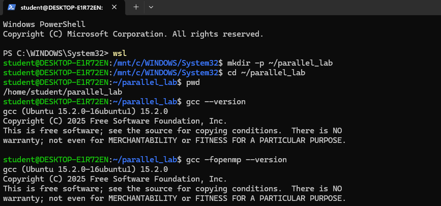
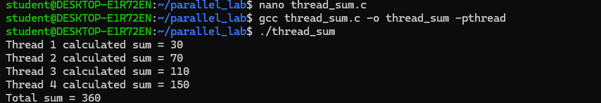
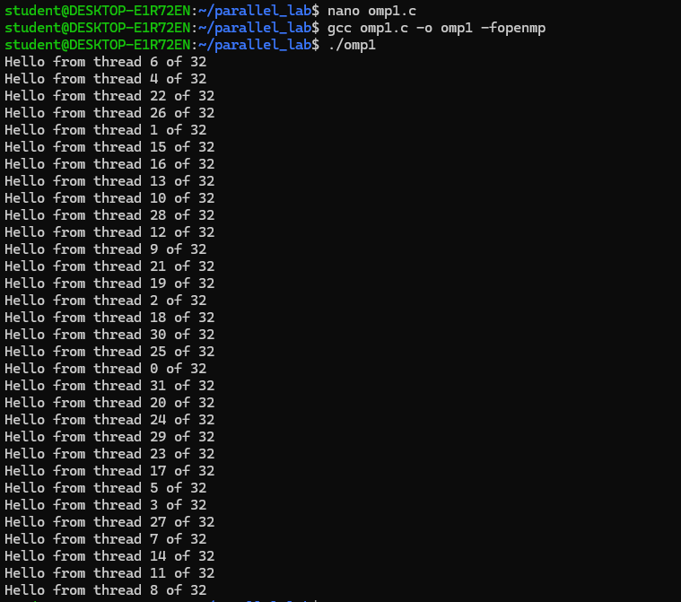
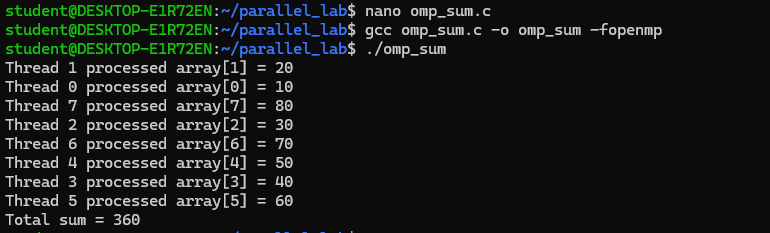
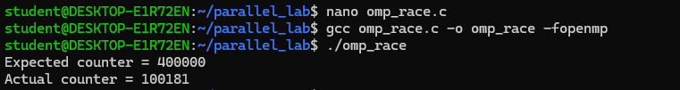
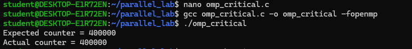
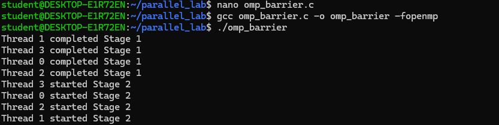
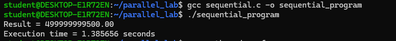
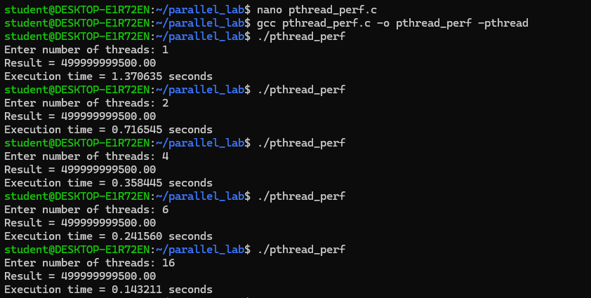
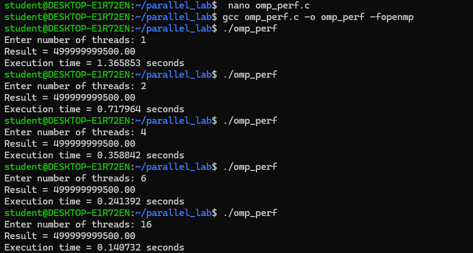

# Parallel and Grid Computing (PGC) - Experiment 2
## Parallel Programming with POSIX Threads (Pthreads) and OpenMP: Concurrency, Synchronization, and Performance Benchmarking

[](https://en.wikipedia.org/wiki/C_(programming_language))
[](https://gcc.gnu.org/)
[](https://man7.org/linux/man-pages/man7/pthreads.7.html)
[](https://www.openmp.org/)
[](https://ubuntu.com/wsl)

---

## Table of Contents
- [1. Objective of the Experiment](#1-objective-of-the-experiment)
- [2. Environment and Lab Setup](#2-environment-and-lab-setup)
- [3. Section 1: POSIX Threads (Pthreads)](#3-section-1-posix-threads-pthreads)
  - [Step 1: Basic Thread Creation and Termination (`thread1.c`)](#step-1-basic-thread-creation-and-termination-thread1c)
  - [Step 2: Concurrent Multi-Threading (`thread2.c`)](#step-2-concurrent-multi-threading-thread2c)
  - [Step 3: Work Partitioning & Parallel Array Summation (`thread_sum.c`)](#step-3-work-partitioning--parallel-array-summation-thread_sumc)
  - [Step 4: Race Conditions in Unsynchronized Shared State (`race.c`)](#step-4-race-conditions-in-unsynchronized-shared-state-racec)
  - [Step 5: Mutual Exclusion with Mutex Locks (`mutex.c`)](#step-5-mutual-exclusion-with-mutex-locks-mutexc)
- [4. Section 2: OpenMP (Open Multi-Processing)](#4-section-2-openmp-open-multi-processing)
  - [Step 6: OpenMP Parallel Region & Thread Identification (`omp1.c`)](#step-6-openmp-parallel-region--thread-identification-omp1c)
  - [Step 7: Work-Sharing Loops & Reduction (`omp_sum.c`)](#step-7-work-sharing-loops--reduction-omp_sumc)
  - [Step 8: Race Condition in Shared Parallel Directives (`omp_race.c`)](#step-8-race-condition-in-shared-parallel-directives-omp_racec)
  - [Step 9: Mutual Exclusion with Critical Directive (`omp_critical.c`)](#step-9-mutual-exclusion-with-critical-directive-omp_criticalc)
  - [Step 10: Barrier Synchronization (`omp_barrier.c`)](#step-10-barrier-synchronization-omp_barrierc)
- [5. Section 3: Performance Analysis and Scalability](#5-section-3-performance-analysis-and-scalability)
  - [Step 11: Sequential Baseline Workload (`sequential.c`)](#step-11-sequential-baseline-workload-sequentialc)
  - [Step 12: Pthreads Scalability Benchmarking (`pthread_perf.c`)](#step-12-pthreads-scalability-benchmarking-pthread_perfc)
  - [Step 13: OpenMP Scalability Benchmarking (`omp_perf.c`)](#step-13-openmp-scalability-benchmarking-omp_perfc)
- [6. Results & Performance Comparison](#6-results--performance-comparison)
- [7. How to Compile and Run](#7-how-to-compile-and-run)
- [8. Repository Directory Structure](#8-repository-directory-structure)

---

## 1. Objective of the Experiment

1. **Understand Shared Memory Concurrency:** Learn the fundamental principles of multi-threaded application design on shared-memory multi-core computer architectures.
2. **Master POSIX Threads (Pthreads):** Gain practical experience writing low-level thread lifecycle management using `pthread_create`, `pthread_join`, and thread arguments.
3. **Examine Synchronization Hazards:** Demonstrate data race conditions when multiple concurrent threads read and write unsynchronized shared memory variables, and implement `pthread_mutex_t` locks to establish mutual exclusion.
4. **Master OpenMP Directives:** Utilize high-level compiler directives (`#pragma omp parallel`, `#pragma omp for`, `reduction`, `#pragma omp critical`, and `#pragma omp barrier`) to achieve thread parallelism with minimal boilerplate.
5. **Conduct Performance Benchmarking & Scaling Analysis:** Measure execution runtime, compute Speedup ($S = T_s / T_p$), and calculate Parallel Efficiency across varying thread counts ($1, 2, 4, 6, 16$) to evaluate multicore scalability and Amdahl's Law constraints.

---

## 2. Environment and Lab Setup

The experiment was carried out in a Linux environment running on Windows Subsystem for Linux (WSL).

### Commands
```bash
wsl
mkdir -p ~/parallel_lab
cd ~/parallel_lab
pwd
gcc --version
gcc -fopenmp --version
```

### Respective Screenshot


---

## 3. Section 1: POSIX Threads (Pthreads)

### Step 1: Basic Thread Creation and Termination (`thread1.c`)
- **Explanation:** Demonstrates the creation of a POSIX thread using `pthread_create()`. The parent thread waits for the completion of the child thread using `pthread_join()` before proceeding to exit.
- **Code:** [`src/section1_pthreads/thread1.c`](src/section1_pthreads/thread1.c)

#### Commands
```bash
nano thread1.c
gcc thread1.c -o thread1 -pthread
./thread1
```

#### Output
```text
Hello from the thread!
Main thread finished.
```

#### Respective Screenshot


---

### Step 2: Concurrent Multi-Threading (`thread2.c`)
- **Explanation:** Spawns 4 concurrent threads, passing a distinct identifier to each thread function. Demonstrates non-deterministic scheduling where thread execution order depends on the operating system scheduler.
- **Code:** [`src/section1_pthreads/thread2.c`](src/section1_pthreads/thread2.c)

#### Commands
```bash
nano thread2.c
gcc thread2.c -o thread2 -pthread
./thread2
```

#### Output
```text
Hello from Thread 1
Hello from Thread 3
Hello from Thread 4
Hello from Thread 2
All threads have finished.
```

#### Respective Screenshot


---

### Step 3: Work Partitioning & Parallel Array Summation (`thread_sum.c`)
- **Explanation:** Partitions an array of 8 integers `{10, 20, 30, 40, 50, 60, 70, 80}` across 4 threads. Each thread computes the sum of its assigned slice (2 elements), and the main thread accumulates the partial sums into the final total ($360$).
- **Code:** [`src/section1_pthreads/thread_sum.c`](src/section1_pthreads/thread_sum.c)

#### Commands
```bash
nano thread_sum.c
gcc thread_sum.c -o thread_sum -pthread
./thread_sum
```

#### Output
```text
Thread 1 calculated sum = 30
Thread 2 calculated sum = 70
Thread 3 calculated sum = 110
Thread 4 calculated sum = 150
Total sum = 360
```

#### Respective Screenshot


---

### Step 4: Race Conditions in Unsynchronized Shared State (`race.c`)
- **Explanation:** 4 concurrent threads each perform $100,000$ increments on a shared global variable without synchronization. Because incrementing (`counter++`) is a non-atomic read-modify-write operation at machine level, threads overwrite each other's increments, resulting in inconsistent and non-deterministic final values far below the expected $400,000$.
- **Code:** [`src/section1_pthreads/race.c`](src/section1_pthreads/race.c)

#### Commands
```bash
nano race.c
gcc race.c -o race -pthread
./race
./race
./race
```

#### Output
```text
Final counter value = 160058
Final counter value = 335471
Final counter value = 117706
```

#### Respective Screenshot


---

### Step 5: Mutual Exclusion with Mutex Locks (`mutex.c`)
- **Explanation:** Resolves the race condition by introducing a POSIX mutex lock (`pthread_mutex_t`). Threads acquire the lock with `pthread_mutex_lock(&lock)` before entering the critical section and release it with `pthread_mutex_unlock(&lock)`, guaranteeing exactly $400,000$.
- **Code:** [`src/section1_pthreads/mutex.c`](src/section1_pthreads/mutex.c)

#### Commands
```bash
nano mutex.c
gcc mutex.c -o mutex -pthread
./mutex
```

#### Output
```text
Final counter value = 400000
```

#### Respective Screenshot


---

## 4. Section 2: OpenMP (Open Multi-Processing)

### Step 6: OpenMP Parallel Region & Thread Identification (`omp1.c`)
- **Explanation:** Introduces the `#pragma omp parallel` compiler directive to spawn a team of threads. Each thread queries its ID via `omp_get_thread_num()` and the team size via `omp_get_num_threads()` (executing 32 threads in parallel).
- **Code:** [`src/section2_openmp/omp1.c`](src/section2_openmp/omp1.c)

#### Commands
```bash
nano omp1.c
gcc omp1.c -o omp1 -fopenmp
./omp1
```

#### Output
```text
Hello from thread 6 of 32
Hello from thread 4 of 32
...
Hello from thread 8 of 32
```

#### Respective Screenshot


---

### Step 7: Work-Sharing Loops & Reduction (`omp_sum.c`)
- **Explanation:** Uses `#pragma omp parallel for reduction(+:total_sum)` to automatically distribute loop iterations across worker threads while performing a thread-safe accumulation of the array sum without manual lock management.
- **Code:** [`src/section2_openmp/omp_sum.c`](src/section2_openmp/omp_sum.c)

#### Commands
```bash
nano omp_sum.c
gcc omp_sum.c -o omp_sum -fopenmp
./omp_sum
```

#### Output
```text
Thread 1 processed array[1] = 20
Thread 0 processed array[0] = 10
Thread 7 processed array[7] = 80
Thread 2 processed array[2] = 30
Thread 6 processed array[6] = 70
Thread 4 processed array[4] = 50
Thread 3 processed array[3] = 40
Thread 5 processed array[5] = 60
Total sum = 360
```

#### Respective Screenshot


---

### Step 8: Race Condition in Shared Parallel Directives (`omp_race.c`)
- **Explanation:** Multiple OpenMP threads increment a shared counter without protection within `#pragma omp parallel num_threads(4)`. Due to simultaneous unsynchronized updates, the actual counter value fails to reach the expected $400,000$.
- **Code:** [`src/section2_openmp/omp_race.c`](src/section2_openmp/omp_race.c)

#### Commands
```bash
nano omp_race.c
gcc omp_race.c -o omp_race -fopenmp
./omp_race
```

#### Output
```text
Expected counter = 400000
Actual counter = 100181
```

#### Respective Screenshot


---

### Step 9: Mutual Exclusion with Critical Directive (`omp_critical.c`)
- **Explanation:** Solves the OpenMP race condition by enclosing the shared variable update inside `#pragma omp critical`. Only one thread executes the increment at any instant, ensuring total correctness ($400,000$).
- **Code:** [`src/section2_openmp/omp_critical.c`](src/section2_openmp/omp_critical.c)

#### Commands
```bash
nano omp_critical.c
gcc omp_critical.c -o omp_critical -fopenmp
./omp_critical
```

#### Output
```text
Expected counter = 400000
Actual counter = 400000
```

#### Respective Screenshot


---

### Step 10: Barrier Synchronization (`omp_barrier.c`)
- **Explanation:** Enforces synchronization across threads using `#pragma omp barrier`. All threads must complete Stage 1 before any thread is allowed to start Stage 2.
- **Code:** [`src/section2_openmp/omp_barrier.c`](src/section2_openmp/omp_barrier.c)

#### Commands
```bash
nano omp_barrier.c
gcc omp_barrier.c -o omp_barrier -fopenmp
./omp_barrier
```

#### Output
```text
Thread 1 completed Stage 1
Thread 3 completed Stage 1
Thread 0 completed Stage 1
Thread 2 completed Stage 1
Thread 3 started Stage 2
Thread 0 started Stage 2
Thread 2 started Stage 2
Thread 1 started Stage 2
```

#### Respective Screenshot


---

## 5. Section 3: Performance Analysis and Scalability

A heavy computational workload summing $100,000,000$ iterations was benchmarked sequentially and across multiple thread configurations ($1, 2, 4, 6, 16$) to evaluate parallel scaling.

### Step 11: Sequential Baseline Workload (`sequential.c`)
- **Explanation:** Executes the computational workload on a single thread to establish the baseline execution time ($T_s$).
- **Code:** [`src/section3_performance/sequential.c`](src/section3_performance/sequential.c)

#### Commands
```bash
gcc sequential.c -o sequential_program
./sequential_program
```

#### Output
```text
Result = 49999999500.00
Execution time = 1.385656 seconds
```

#### Respective Screenshot


---

### Step 12: Pthreads Scalability Benchmarking (`pthread_perf.c`)
- **Explanation:** Benchmarks the workload using POSIX Threads partitioned evenly across dynamic thread counts ($1, 2, 4, 6, 16$).
- **Code:** [`src/section3_performance/pthread_perf.c`](src/section3_performance/pthread_perf.c)

#### Commands
```bash
nano pthread_perf.c
gcc pthread_perf.c -o pthread_perf -pthread
./pthread_perf
```

#### Output Across Thread Counts
- **1 Thread:** `1.370635 seconds`
- **2 Threads:** `0.716545 seconds`
- **4 Threads:** `0.358445 seconds`
- **6 Threads:** `0.241560 seconds`
- **16 Threads:** `0.143211 seconds`

#### Respective Screenshot


---

### Step 13: OpenMP Scalability Benchmarking (`omp_perf.c`)
- **Explanation:** Benchmarks the workload using OpenMP parallel for loop directives across dynamic thread counts ($1, 2, 4, 6, 16$).
- **Code:** [`src/section3_performance/omp_perf.c`](src/section3_performance/omp_perf.c)

#### Commands
```bash
nano omp_perf.c
gcc omp_perf.c -o omp_perf -fopenmp
./omp_perf
```

#### Output Across Thread Counts
- **1 Thread:** `1.365853 seconds`
- **2 Threads:** `0.717964 seconds`
- **4 Threads:** `0.358842 seconds`
- **6 Threads:** `0.241392 seconds`
- **16 Threads:** `0.140732 seconds`

#### Respective Screenshot


---

## 6. Results & Performance Comparison

### Benchmark Comparison Table

| Threads ($p$) | Sequential Time ($T_s$) | Pthreads Time ($T_p$) | Pthreads Speedup ($S_p$) | Pthreads Efficiency ($E_p$) | OpenMP Time ($T_{omp}$) | OpenMP Speedup ($S_{omp}$) | OpenMP Efficiency ($E_{omp}$) |
|:---:|:---:|:---:|:---:|:---:|:---:|:---:|:---:|
| **1** | 1.385656 s | 1.370635 s | 1.01x | 101.1% | 1.365853 s | 1.01x | 101.5% |
| **2** | 1.385656 s | 0.716545 s | 1.93x | 96.7% | 0.717964 s | 1.93x | 96.5% |
| **4** | 1.385656 s | 0.358445 s | 3.87x | 96.6% | 0.358842 s | 3.86x | 96.5% |
| **6** | 1.385656 s | 0.241560 s | 5.74x | 95.6% | 0.241392 s | 5.74x | 95.7% |
| **16** | 1.385656 s | 0.143211 s | 9.68x | 60.5% | 0.140732 s | 9.85x | 61.5% |

### Key Observations
1. **Linear Speedup:** Threads from $1$ to $6$ exhibit near-ideal linear scaling (~$96\%$ efficiency) with speedups reaching $5.74\times$.
2. **Amdahl's Law and SMT Overhead:** At $16$ threads, parallel speedup approaches $9.85\times$ (~$0.140$s runtime) with an efficiency of ~$61\%$, attributed to physical CPU core saturation, hyperthreading memory bus contention, and synchronization overhead.
3. **Pthreads vs OpenMP:** Both programming models perform identically well, while OpenMP significantly reduces development effort and source code verbosity.

> For the comprehensive benchmark breakdown and CSV data, refer to [`results/benchmark_analysis.md`](results/benchmark_analysis.md) and [`results/performance_data.csv`](results/performance_data.csv).

---

## 7. How to Compile and Run

### Option A: Using the Automated Makefile
```bash
# Compile all programs across all sections into bin/
make all

# Or compile individual sections
make section1
make section2
make section3

# Clean all binaries
make clean
```

### Option B: Compiling Programs Individually
```bash
# Section 1 (Pthreads)
gcc src/section1_pthreads/thread1.c -o thread1 -pthread
gcc src/section1_pthreads/thread2.c -o thread2 -pthread
gcc src/section1_pthreads/thread_sum.c -o thread_sum -pthread
gcc src/section1_pthreads/race.c -o race -pthread
gcc src/section1_pthreads/mutex.c -o mutex -pthread

# Section 2 (OpenMP)
gcc src/section2_openmp/omp1.c -o omp1 -fopenmp
gcc src/section2_openmp/omp_sum.c -o omp_sum -fopenmp
gcc src/section2_openmp/omp_race.c -o omp_race -fopenmp
gcc src/section2_openmp/omp_critical.c -o omp_critical -fopenmp
gcc src/section2_openmp/omp_barrier.c -o omp_barrier -fopenmp

# Section 3 (Performance Benchmarking)
gcc src/section3_performance/sequential.c -o sequential_program
gcc src/section3_performance/pthread_perf.c -o pthread_perf -pthread
gcc src/section3_performance/omp_perf.c -o omp_perf -fopenmp
```

---

## 8. Repository Directory Structure

```
PGC-Experiment-2/
├── .gitignore                          # C compilation and IDE ignore rules
├── Makefile                            # Automated build configuration
├── README.md                           # Lab documentation with steps and screenshots
├── results/
│   ├── benchmark_analysis.md           # Speedup and efficiency scalability analysis
│   └── performance_data.csv            # Tabular benchmark metrics
├── ss/                                 # Experiment screenshots
│   ├── 01_environment_setup.png
│   ├── 02_pthreads_thread1.png
│   ├── 03_pthreads_thread2.png
│   ├── 04_pthreads_sum.png
│   ├── 05_pthreads_race_condition.png
│   ├── 06_pthreads_mutex_solution.png
│   ├── 07_openmp_hello.png
│   ├── 08_openmp_sum.png
│   ├── 09_openmp_race_condition.png
│   ├── 10_openmp_critical_solution.png
│   ├── 11_openmp_barrier.png
│   ├── 12_sequential_performance.png
│   ├── 13_pthreads_scaling_performance.png
│   └── 14_openmp_scaling_performance.png
└── src/
    ├── section1_pthreads/              # POSIX Threads implementations
    │   ├── thread1.c
    │   ├── thread2.c
    │   ├── thread_sum.c
    │   ├── race.c
    │   └── mutex.c
    ├── section2_openmp/                # OpenMP implementations
    │   ├── omp1.c
    │   ├── omp_sum.c
    │   ├── omp_race.c
    │   ├── omp_critical.c
    │   └── omp_barrier.c
    └── section3_performance/          # Performance benchmark programs
        ├── sequential.c
        ├── pthread_perf.c
        └── omp_perf.c
```